# Entity-Relationship (ER) Diagram & Data Architecture Specification
## Project: Bilingual Voice Translation System With Emotion Awareness (VoiceAffect)

---

## 1. Entity-Relationship Overview

VoiceAffect is designed with a **privacy-first local architecture**. While media files and session buffers are managed ephemerally to prevent persistent surveillance or storage of personal speech data, the system structures data around formalized entities across the execution lifecycle.

The diagram below specifies the **Conceptual and Logical Data Model** representing translation sessions, audio streams, transcription outputs, emotion/prosody vectors, model metadata, and latency diagnostics.

```mermaid
erDiagram
    TRANSLATION_SESSION ||--o{ UTTERANCE_SEGMENT : "contains"
    UTTERANCE_SEGMENT ||--o{ AUDIO_ARTIFACT : "produces / references"
    UTTERANCE_SEGMENT ||--|| TRANSCRIPTION_RECORD : "yields"
    UTTERANCE_SEGMENT ||--|| EMOTION_TELEMETRY : "captures"
    UTTERANCE_SEGMENT ||--|| TRANSLATION_RECORD : "generates"
    UTTERANCE_SEGMENT ||--|| PROSODY_GATING_PLAN : "derives"
    UTTERANCE_SEGMENT ||--|| PIPELINE_LATENCY_METRIC : "records"
    
    MODEL_REGISTRY_ITEM ||--o{ TRANSCRIPTION_RECORD : "executes"
    MODEL_REGISTRY_ITEM ||--o{ EMOTION_TELEMETRY : "executes"
    MODEL_REGISTRY_ITEM ||--o{ TRANSLATION_RECORD : "executes"
    MODEL_REGISTRY_ITEM ||--o{ PROSODY_GATING_PLAN : "executes"
    
    UTTERANCE_SEGMENT ||--o| SCIENTIFIC_EVALUATION : "audited_by"
    SCIENTIFIC_BENCHMARK ||--o{ SCIENTIFIC_EVALUATION : "calibrates"

    TRANSLATION_SESSION {
        string session_id PK "UUIDv4 8-char identifier"
        string client_type "WEBSOCKET_STREAM | REST_UPLOAD | REST_TEXT"
        string source_language "hi | en | auto"
        string target_language "hi | en"
        boolean auto_play_enabled "Flag for immediate voice playback"
        boolean user_consent_granted "Explicit consent for vocal prosody adaptation"
        timestamp created_at "Session initialization timestamp"
        timestamp last_activity_at "Heartbeat & timeout tracker"
        string status "ACTIVE | FLUSHING | TIMED_OUT | CLOSED"
    }

    UTTERANCE_SEGMENT {
        string segment_id PK "Deterministic ID or integer sequence"
        string session_id FK "Parent session reference"
        int sequence_number "Ordered index for progressive playback"
        string input_mode "LIVE_MIC | BATCH_FILE | DIRECT_TEXT"
        int sample_count "Number of PCM samples captured"
        float duration_seconds "Length of speech segment"
        float rms_energy "Acoustic energy level"
        boolean speech_detected "VAD gate outcome (RMS >= 0.008)"
        timestamp captured_at "Audio ingestion timestamp"
        timestamp completed_at "Pipeline completion timestamp"
    }

    AUDIO_ARTIFACT {
        string artifact_id PK "Unique hash or filename"
        string segment_id FK "Associated utterance segment"
        string artifact_type "ORIGINAL_INPUT | SYNTHESIZED_OUTPUT"
        string file_path "Local path in /temp_storage"
        string format "WAV | MP3 | M4A | WEBM"
        int sample_rate "Target 16000 Hz"
        int channels "Mono (1 channel)"
        int bit_depth "16-bit signed integer PCM"
        int file_size_bytes "Size on disk"
        boolean is_ephemeral "Flagged for cleanup on session end"
        timestamp expires_at "Garbage collection threshold"
    }

    TRANSCRIPTION_RECORD {
        string transcription_id PK "Unique transcription ID"
        string segment_id FK "Associated utterance segment"
        string model_id FK "Model used (Whisper-Tiny)"
        string recognized_text "Source transcribed text"
        string detected_language "Detected language code (hi or en)"
        float confidence_score "Acoustic posterior confidence C (Eq. 4)"
        int token_count "Number of tokens decoded"
        float asr_duration_ms "Inference execution latency"
    }

    EMOTION_TELEMETRY {
        string telemetry_id PK "Unique telemetry record ID"
        string segment_id FK "Associated utterance segment"
        string model_id FK "Model used (Wav2Vec2 + Eq. 5)"
        string dominant_emotion "Neutral | Happy | Sad | Angry | Fearful | Surprised"
        float emotion_confidence "Softmax probability of dominant class"
        float prob_neutral "Neutral posterior [0.0 - 1.0]"
        float prob_happy "Happy posterior [0.0 - 1.0]"
        float prob_sad "Sad posterior [0.0 - 1.0]"
        float prob_angry "Angry posterior [0.0 - 1.0]"
        float prob_fearful "Fearful posterior [0.0 - 1.0]"
        float prob_surprised "Surprised posterior [0.0 - 1.0]"
        float valence "Valence coordinate V in [0.0 - 1.0]"
        float arousal "Arousal coordinate A in [0.0 - 1.0]"
        float dominance "Dominance coordinate D in [0.0 - 1.0]"
        float ser_duration_ms "Acoustic extraction and SER latency"
    }

    TRANSLATION_RECORD {
        string translation_id PK "Unique translation record ID"
        string segment_id FK "Associated utterance segment"
        string model_id FK "Model used (Helsinki-NLP MarianMT)"
        string source_text "Input text provided to NMT"
        string translated_text "Translated output text"
        string source_lang "Source language (hi or en)"
        string target_lang "Target language (en or hi)"
        float nmt_duration_ms "Translation latency"
    }

    PROSODY_GATING_PLAN {
        string plan_id PK "Unique gating plan ID"
        string segment_id FK "Associated utterance segment"
        float gating_weight_z "Latent-depth gating weight z_l (Eq. 8)"
        float pitch_multiplier "Vocal pitch scaling factor delta_f0"
        float rate_multiplier "Speaking tempo multiplier delta_r"
        float volume_multiplier "Amplitude gain multiplier delta_v"
        string target_emotion "Assigned emotional category"
        string prosody_notes "Natural language description of acoustics"
        boolean expressive_synthesis_supported "Whether voice engine supports emotion conditioning"
        string synthesis_voice_used "Operating system voice profile identifier"
        boolean speaker_similarity_retained "Vocal identity retention status (consent gated)"
        string emotional_fidelity_status "Truthful disclosure on achieved fidelity"
    }

    PIPELINE_LATENCY_METRIC {
        string metric_id PK "Unique metric measurement ID"
        string segment_id FK "Associated utterance segment"
        float feature_extraction_ms "FFT / MFCC extraction latency"
        float asr_ms "Whisper ASR inference time"
        float ser_ms "Wav2Vec2 emotion recognition time"
        float nmt_ms "MarianMT machine translation time"
        float tts_ms "Speech synthesis & prosody time"
        float total_pipeline_ms "End-to-end roundtrip latency"
        boolean within_latency_budget "True if total_pipeline_ms <= 3500ms"
    }

    MODEL_REGISTRY_ITEM {
        string model_id PK "Unique module identifier"
        string module_type "ASR | SER | NMT | GATING | TTS"
        string model_name "HuggingFace identifier or local engine"
        string device "mps | cpu | system"
        string supported_languages "hi, en"
        string scientific_basis "Mathematical paper reference (Eq. 1-9)"
        boolean is_loaded "Whether weights are in-memory"
        string license "Apache-2.0 | MIT | System"
    }

    SCIENTIFIC_BENCHMARK {
        string benchmark_id PK "Unique benchmark record ID"
        string metric_name "Transcription Accuracy | UAR | BLEU | Latency | MOS"
        string paper_literature_claim "Published claim from literature"
        string citation "Author and publication reference"
        string local_measured_target "Empirical verification target"
        string verification_method "Token probability | Cosine similarity | Monotonic clock"
    }

    SCIENTIFIC_EVALUATION {
        string evaluation_id PK "Evaluation run ID"
        string segment_id FK "Associated utterance segment"
        string benchmark_id FK "Reference benchmark rule"
        float source_confidence "Original speech classification confidence"
        float generated_confidence "Synthesized speech classification confidence"
        boolean label_match "True if generated audio retains source emotion label"
        float distribution_cosine_similarity "Cosine similarity of emotion probability vectors"
        float estimated_snr_db "Acoustic Signal-to-Noise Ratio"
        float pitch_continuity_ratio "Continuity of fundamental frequency contour"
        float estimated_mos_proxy "Heuristic Mean Opinion Score proxy"
        string retention_verdict "Full Retention | Partial Prosodic Shift | Flat Monotone"
    }
```

---

## 2. Detailed Data Dictionary

### 2.1 TRANSLATION_SESSION
Tracks an interactive user session across WebSocket or REST endpoints.
* **`session_id`** (`VARCHAR(36)`, PK): Unique identifier for the user session (generated via UUID).
* **`client_type`** (`VARCHAR(20)`): Originating interface modality (`WEBSOCKET_STREAM`, `REST_UPLOAD`, `REST_TEXT`).
* **`source_language`** (`VARCHAR(10)`): Configured input language (`hi`, `en`, or `auto`).
* **`target_language`** (`VARCHAR(10)`): Desired translation language (`en` or `hi`).
* **`auto_play_enabled`** (`BOOLEAN`): Controls whether synthesized voice segments immediately play on the client.
* **`user_consent_granted`** (`BOOLEAN`): Legal/ethical gating ensuring voice modulation and prosody analysis is explicitly permitted.
* **`status`** (`VARCHAR(15)`): Lifecycle state (`ACTIVE`, `FLUSHING`, `TIMED_OUT`, `CLOSED`).

### 2.2 UTTERANCE_SEGMENT
Represents a discrete speech unit (typically 1.5s to 3.0s in live streaming, or an uploaded recording).
* **`segment_id`** (`VARCHAR(36)`, PK): Unique identifier for the processing unit.
* **`session_id`** (`VARCHAR(36)`, FK): Parent session reference.
* **`sequence_number`** (`INTEGER`): Incremental order index used by the progressive playback queue to guarantee in-order delivery.
* **`rms_energy`** (`FLOAT`): Root-Mean-Square acoustic energy calculated via:
  $$E_{\text{RMS}} = \sqrt{\frac{1}{N}\sum_{n=1}^N x[n]^2}$$
* **`speech_detected`** (`BOOLEAN`): VAD decision gate. Evaluated against $E_{\text{RMS}} \ge 0.008$. If `False`, downstream cognitive models are skipped to conserve compute.

### 2.3 AUDIO_ARTIFACT
Tracks temporary audio files stored on disk in `temp_storage/`.
* **`artifact_id`** (`VARCHAR(64)`, PK): Filename or content hash.
* **`artifact_type`** (`VARCHAR(25)`): Role of audio (`ORIGINAL_INPUT`, `SYNTHESIZED_OUTPUT`).
* **`file_path`** (`VARCHAR(255)`): Local filesystem path.
* **`sample_rate`** (`INTEGER`): Standardized to `16000` Hz.
* **`channels`** (`INTEGER`): Standardized to `1` (Mono).
* **`is_ephemeral`** (`BOOLEAN`): Always `True` in local privacy mode; cleaned by background garbage collector.

### 2.4 TRANSCRIPTION_RECORD
Encapsulates Automatic Speech Recognition (ASR) outputs.
* **`recognized_text`** (`TEXT`): Output string transcribed by Whisper Transformer.
* **`confidence_score`** (`FLOAT`): Mathematical confidence score $C \in [0.0, 1.0]$ derived from token sequence log probabilities (Eq. 4).
* **`detected_language`** (`VARCHAR(10)`): Language detected by Whisper (`hi` or `en`).

### 2.5 EMOTION_TELEMETRY
Captures Speech Emotion Recognition (SER) classifications and continuous paralinguistic vectors.
* **`dominant_emotion`** (`VARCHAR(20)`): Argmax prediction among 6 classes: `Neutral`, `Happy`, `Sad`, `Angry`, `Fearful`, `Surprised`.
* **`emotion_confidence`** (`FLOAT`): Probability posterior of the dominant class.
* **`valence`** (`FLOAT`): Valence dimension $V \in [0.0, 1.0]$ (intrinsic pleasantness / positivity).
* **`arousal`** (`FLOAT`): Arousal dimension $A \in [0.0, 1.0]$ (energy / physiological activation level).
* **`dominance`** (`FLOAT`): Dominance dimension $D \in [0.0, 1.0]$ (sense of control / vocal assertiveness).

### 2.6 PROSODY_GATING_PLAN
Calculates target acoustic modifications to synthesize the translated voice expressively.
* **`gating_weight_z`** (`FLOAT`): Neuro-symbolic activation weight $z_l \in [0.0, 1.0]$ computed via:
  $$z_l = \sigma(W_v \cdot V + W_a \cdot A + W_d \cdot D + b)$$
* **`pitch_multiplier`** ($\Delta f_0$, `FLOAT`): Relative scaling of target fundamental frequency (e.g. $1.15\times$ for Happy/Angry, $0.85\times$ for Sad).
* **`rate_multiplier`** ($\Delta r$, `FLOAT`): Relative tempo adjustment (e.g. $1.08\times$ for Urgent, $0.88\times$ for Empathetic).
* **`speaker_similarity_retained`** (`BOOLEAN`): Discloses that biological timbre is dissociated from emotional prosody to protect voice privacy.

### 2.7 PIPELINE_LATENCY_METRIC
Tracks fine-grained execution timestamps across each pipeline stage to audit the real-time $\le 3.5$s requirement.
* **`asr_ms`**, **`ser_ms`**, **`nmt_ms`**, **`tts_ms`** (`FLOAT`): Measured in high-precision monotonic milliseconds.
* **`total_pipeline_ms`** (`FLOAT`): End-to-end roundtrip processing latency.

---

## 3. Data Integrity, Privacy & Retention Policies

1. **Local Privacy Enforcement**:
   * No user audio or text transcripts are sent to third-party cloud APIs.
   * All neural inference executes on the local host machine using Apple Silicon MPS or local CPU.
2. **Ephemeral Storage Lifecycle**:
   * Audio artifacts stored in `temp_storage/` are assigned an automatic time-to-live (TTL) of 1 hour.
   * The server runs a cleanup routine to delete temporary WAV files upon session termination or server restart.
3. **Voice Consent Gating**:
   * Speaker identity cloning is disabled by default (`speaker_similarity_retained = False`).
   * Expressive prosody is modulated through acoustic physics (pitch contour, speech tempo, energy scaling) rather than neural voice cloning.
