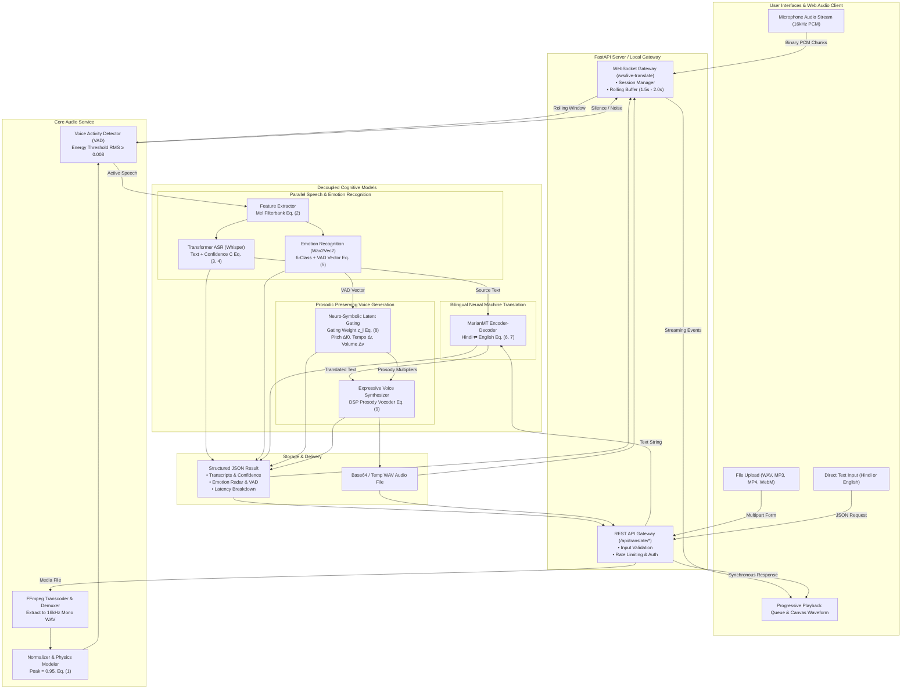
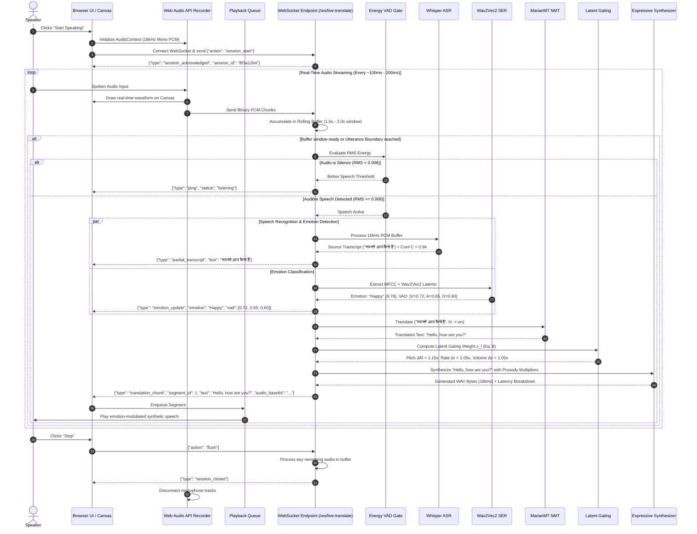
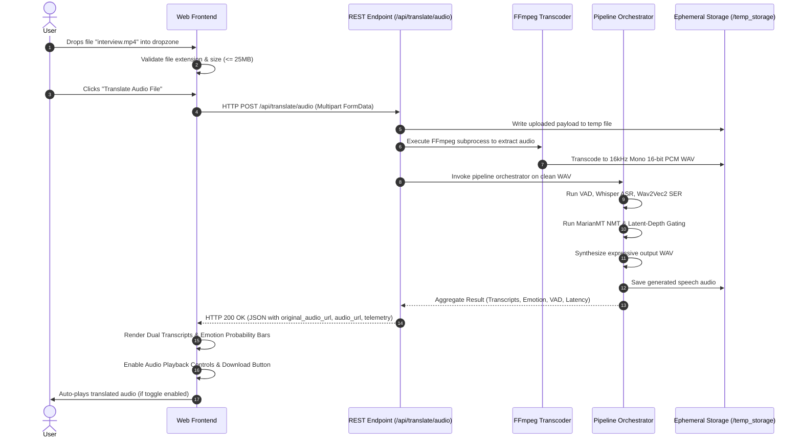
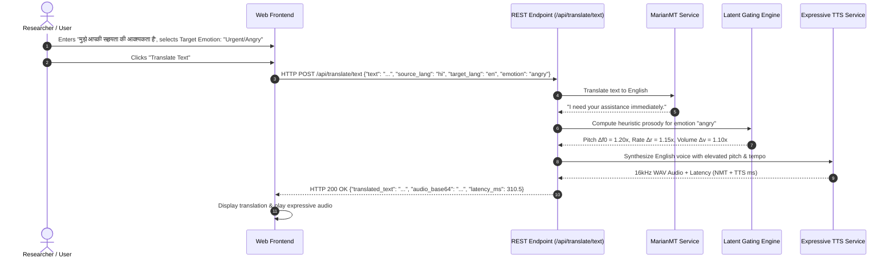
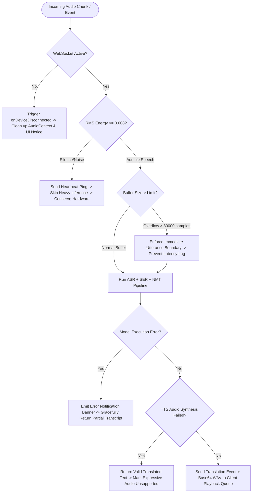

# Project Workflow Specification & Process Architecture
## Project: Bilingual Voice Translation System With Emotion Awareness (VoiceAffect)

---

## 1. High-Level Process Architecture

The VoiceAffect system coordinates three primary operational workflows:
1. **Real-Time Live Speech Streaming Workflow** (WebSocket full-duplex session).
2. **Batch Audio File Ingestion Workflow** (REST multipart upload).
3. **Direct Text Translation & Expressive Synthesis Workflow** (REST JSON payload).

---

## 2. Sequence Workflow 1: Real-Time Live Speech Streaming (WebSocket)

This is the primary user interaction workflow. The browser captures microphone audio via Web Audio API, resamples it to 16 kHz Mono PCM, and streams binary chunks across a WebSocket connection.

---

## 3. Sequence Workflow 2: Batch Audio File Upload & Processing

Used when translating pre-recorded interviews, voice notes, or video clips (WAV, MP3, M4A, FLAC, WebM, MP4 up to 25 MB).

---

## 4. Sequence Workflow 3: Direct Text Translation & Expressive Synthesis

Used for testing prosodic modulation directly by providing source text and selecting a desired emotional disposition.

---

## 5. Pipeline Mathematical Transformation Signatures

| Stage | Input Domain | Output Domain | Governing Mathematical Formula |
| :--- | :--- | :--- | :--- |
| **1. Acquisition & VAD** | Raw Audio Signal $s(t)$ | Normalized Mono 16kHz $x(t) \in [-1.0, 1.0]$ | **Eq. (1)**: $x(t) = A(t) \cdot \sin(2\pi f t + \phi)$; $E_{\text{RMS}} = \sqrt{\frac{1}{N}\sum x[n]^2} \ge 0.008$ |
| **2. Feature Extraction** | PCM Array $x[n]$ | Mel Frequency Log Energies $M \in \mathbb{R}^{T \times 80}$ | **Eq. (2)**: $M(f) = 2595 \cdot \log_{10}(1 + f / 700)$ via 25ms STFT window |
| **3. Whisper ASR** | Mel Spectrogram $M$ | Sequence of Tokens $W = \{w_1, \dots, w_T\}$ | **Eq. (3, 4)**: $P(W\|X) = \prod_{t=1}^T P(w_t \| w_{<t}, X)$; Conf $C = \frac{1}{T}\sum \log P(w_t)$ |
| **4. Wav2Vec2 SER** | Raw Audio $x(t)$ + MFCC | 6-Class Probs $P(e)$ + VAD Vector $\vec{v} \in [0, 1]^3$ | **Eq. (5)**: $H_{\text{SER}} = \text{Softmax}(W_a \cdot F_{\text{wav2vec}} + W_p \cdot F_{\text{acoustic}} + b)$ |
| **5. MarianMT NMT** | Source Text Tokens $W_{\text{src}}$ | Target Text Tokens $Y = \{y_1, \dots, y_U\}$ | **Eq. (6, 7)**: $\text{Attention}(Q, K, V) = \text{softmax}\left(\frac{QK^T}{\sqrt{d_k}}\right)V$ |
| **6. Latent Gating** | VAD Vector $(V, A, D)$ | Latent Weight $z_l \in [0, 1]$ & Multipliers $(\Delta f_0, \Delta r, \Delta v)$ | **Eq. (8)**: $z_l = \sigma(W_v \cdot V + W_a \cdot A + W_d \cdot D + b)$ |
| **7. Expressive TTS** | Target Text $Y$ + $(\Delta f_0, \Delta r)$ | Target Audio Waveform $y_{\text{synth}}(t)$ | **Eq. (9)**: $y(t) = \text{Vocoder}\left(Y, f_0 \cdot \Delta f_0, r \cdot \Delta r, v \cdot \Delta v\right)$ |

---

## 6. Error Handling & Edge Case Workflows

