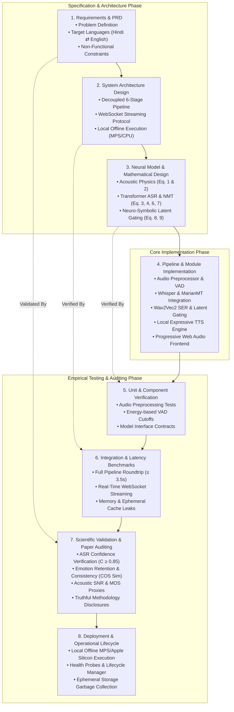
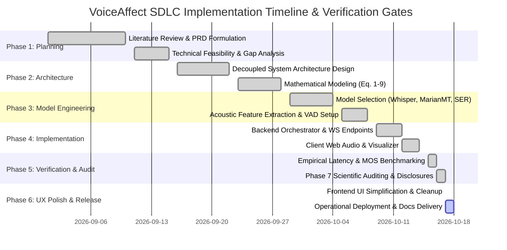

# Software Development Life Cycle (SDLC) Specification
## Project: Bilingual Voice Translation System With Emotion Awareness (VoiceAffect)

---

## 1. SDLC Methodology Overview

VoiceAffect is engineered using an **Agile-V-Model Hybrid SDLC** tailored for Deep Learning Speech Processing and Paralinguistic Systems. This methodology combines the rapid iterative sprints of Agile with the rigorous verification and validation checkpoints of the V-Model.

Because neural speech systems (ASR, SER, NMT, Latent Gating, TTS) suffer from **cascaded error propagation** where upstream acoustic or phonetic errors multiply downstream, every development phase is strictly paired with a corresponding empirical verification gate.

---

## 2. Phase-by-Phase SDLC Breakdown

### Phase 1: Requirements Engineering & Literature Grounding
* **Objective**: Formulate the problem statement based on peer-reviewed Cross-Language Speech Translation (CLST) literature and define actionable project goals.
* **Key Inputs**:
  * Research Paper: *"Bilingual Voice Translation System With Emotion Awareness"* (Ayush Singh Mehta, Hardik Mishra, Hardik Sishodia, Amit Sharma — Sharda University).
  * Limitations of conventional CLST: Affective flattening, vocal identity dissociation, and lack of Hindi parallel emotional datasets.
* **Key Deliverables**:
  * Product Requirements Document (`prd.md`).
  * Requirement Traceability Matrix (`requirement.md`).
  * Architectural Decisions & Methodology Disclosures (`decision.md`).
* **Exit Criteria**:
  * Clear functional requirements for Live Speech, File Upload, and Direct Text translation.
  * Explicit latency target ($\le 3.5$s end-to-end) and local offline inference constraints (Zero paid cloud APIs, complete data privacy).

---

### Phase 2: System Architecture & Mathematical Specification
* **Objective**: Design a decoupled, non-blocking modular architecture ensuring real-time responsiveness and scientific rigor.
* **Key Tasks**:
  * Design decoupled client-server topology (FastAPI backend + Vanilla HTML5/CSS/JS frontend).
  * Define bidirectional WebSocket protocol (`/ws/live-translate`) with sliding-window chunking.
  * Formalize mathematical pipeline equations:
    * **Eq. (1)**: Audio acquisition waveform modeling $x(t) = A(t) \cdot \sin(2\pi f t + \phi)$.
    * **Eq. (2)**: Mel Filterbank feature representation $M(f) = 2595 \cdot \log_{10}(1 + f / 700)$.
    * **Eq. (3, 4)**: Transformer ASR posterior decoding and utterance confidence $C = \frac{1}{T}\sum_{t=1}^T \log P(w_t | w_{<t}, X)$.
    * **Eq. (5)**: Acoustic-prosodic multimodal feature fusion for SER.
    * **Eq. (6, 7)**: Bidirectional encoder-decoder self-attention for Hindi $\leftrightarrow$ English NMT.
    * **Eq. (8)**: Neuro-symbolic latent-depth prosody gating $z_l = \sigma(W_v \cdot V + W_a \cdot A + W_d \cdot D + b)$.
    * **Eq. (9)**: Target speech synthesis prosodic scaling $(\Delta f_0, \Delta r, \Delta v)$.
* **Key Deliverables**:
  * Architecture Document (`docs/ARCHITECTURE.md`).
  * OpenAPI REST & WebSocket Contract (`docs/api-contract.md`).
* **Exit Criteria**:
  * Module contracts approved with explicit error codes and latency breakdown schemas.

---

### Phase 3: Neural Model Selection, Adaptation & Prototyping
* **Objective**: Evaluate, select, and integrate local open-source neural models meeting license, memory, and Apple Silicon/MPS acceleration constraints.
* **Component Matrix**:
  | Module | Selected Checkpoint / Engine | Device Support | Role & Scientific Justification |
  | :--- | :--- | :--- | :--- |
  | **ASR** | `openai/whisper-tiny` | MPS / CPU | Multilingual Hindi/English speech transcription; robust to acoustic noise |
  | **SER** | `ehcalabres/wav2vec2-lg-xlsr-en-speech-emotion-recognition` | MPS / CPU | 8-class $\to$ 6-class emotion mapping + continuous VAD coordinate extraction |
  | **NMT** | `Helsinki-NLP/opus-mt-hi-en` & `opus-mt-en-hi` | MPS / CPU | Bilingual sequence-to-sequence translation with subword tokenization |
  | **Gating** | Custom Neuro-Symbolic Latent Engine | CPU | Computes latent weight $z_l$ (Eq. 8) and maps VAD to prosody multipliers |
  | **TTS** | Native OS Speech Engine + DSP Prosody Vocoder | System / Native | Offline synthesis supporting Hindi & English with pitch & tempo scaling |
* **Key Deliverables**:
  * Model Matrix Document (`docs/model-matrix.md`).
  * Model lifecycle manager with lazy loading and memory conservation (`backend/app/services/model_lifecycle.py`).
* **Exit Criteria**:
  * All models pass initialization tests without external network dependencies.

---

### Phase 4: Core Implementation & Progressive Streaming
* **Objective**: Implement the full pipeline, WebSocket streaming handler, and frontend user interface.
* **Backend Implementation**:
  * `backend/app/core/audio_processor.py`: Audio normalization, resampling to 16 kHz Mono PCM, energy-based VAD.
  * `backend/app/services/pipeline.py`: Asynchronous pipeline orchestrator tying together ASR, SER, NMT, Latent Gating, and TTS.
  * `backend/app/api/endpoints/websocket.py`: Full-duplex session manager, sliding-window buffer, utterance boundary detector.
* **Frontend Implementation**:
  * `frontend/js/audio.js`: Web Audio API capture, downsampling, and real-time visualizer.
  * `frontend/js/playback_queue.js`: Progressive audio queue ensuring synchronized, jitter-free playback.
  * `frontend/index.html` & CSS: Clean, modern, distraction-free interface.
* **Key Deliverables**:
  * End-to-end runnable application on `localhost:8000`.
* **Exit Criteria**:
  * Zero browser console errors; successful audio recording, translation, and voice playback roundtrip.

---

### Phase 5: Verification, Validation & Benchmarking
* **Objective**: Conduct rigorous empirical testing across functionality, latency, and scientific claims.
* **Testing Dimensions**:
  * **Unit Testing**: Pytest suite for individual modules (FFmpeg extraction, audio resampling, VAD energy cutoff).
  * **Integration Testing**: WebSocket session handshake, cancellation, flush, and timeout handling.
  * **Latency Benchmarks**: Automated measuring of each stage's latency against the $\le 3.5$s requirement.
  * **Scientific Fidelity Audit**: Evaluation of emotion retention consistency between input speech and synthesized audio.
* **Key Deliverables**:
  * Test Suite (`tests/test_api.py`, `tests/test_pipeline.py`, etc.).
  * Scientific Audit Report (`docs/phase7-audit-report.md`).
* **Exit Criteria**:
  * 100% of integration test suites pass; verified offline operation without internet connectivity.

---

### Phase 6: Deployment, Optimization & Maintenance
* **Objective**: Ensure long-running operational stability, memory reclamation, and graceful error handling.
* **Key Operational Tasks**:
  * PyTorch device allocation (`mps` on macOS Apple Silicon, `cuda` on Nvidia Linux, `cpu` fallback).
  * Ephemeral audio garbage collection cleaning `temp_storage/` to prevent disk bloat.
  * Idle session cleanup in WebSocket gateway (120-second inactivity timeout).
  * Health check probes (`/api/health`) tracking uptime and module readiness.
* **Key Deliverables**:
  * Production-ready deployment scripts and documentation (`README.md`).

---

## 3. SDLC Stage Traceability Matrix

