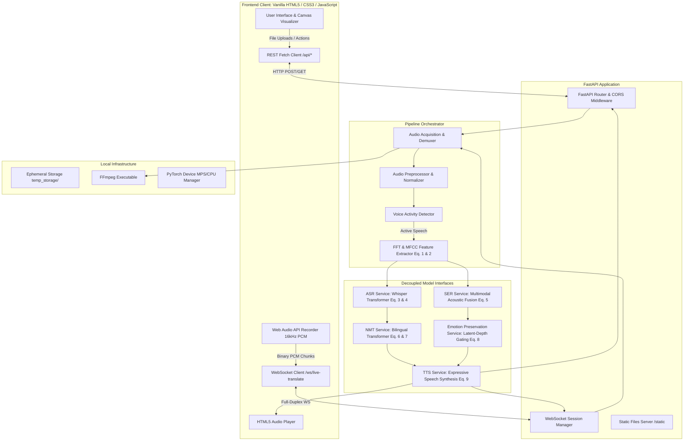

# Detailed System Architecture & Module Contracts (docs/architecture.md)

## Project: Bilingual Voice Translation System With Emotion Awareness (VoiceAffect)

---

## 1. Architectural Overview & Component Topology



---

## 2. Core Service Modules & Interfaces

### 2.1 Native Frontend Client
- **Files**: `frontend/index.html`, `frontend/css/style.css`, `frontend/js/app.js`.
- **Responsibilities**:
  - Live microphone capture using `navigator.mediaDevices.getUserMedia` with `channelCount: 1, sampleRate: 16000`.
  - Downsampling / PCM quantization converting Float32 Web Audio buffers into 16-bit signed PCM `Int16Array`.
  - Continuous real-time animated frequency visualizer rendering on HTML5 Canvas using an `AnalyserNode` (FFT size 128).
  - Drag-and-drop file upload zone for existing audio/video recordings.
  - Side-by-side synchronized rendering of source and translated speech captions.
  - Emotion awareness telemetry display: 6-emotion probability radar, Valence-Arousal-Dominance (VAD) meters, and Latent-Depth Gating parameters.
  - Stage-by-stage latency monitoring dashboard (ASR ms, SER ms, NMT ms, TTS ms, Total ms).

### 2.2 Live Audio Session Manager & WebSocket Gateway
- **Endpoint**: `WS /ws/live-translate`.
- **Responsibilities**:
  - Maintains persistent connection per active client.
  - Receives streaming binary audio frames and accumulates them in an adaptive rolling buffer.
  - Implements sliding-window segmentation (triggering processing every 1.5 to 2.0 seconds of accumulated audio).
  - Handles client flush control messages (`{"action": "flush"}`) when the user pauses or stops speaking.

### 2.3 Audio Acquisition & Preprocessing Service
- **Module**: `backend/app/core/audio_processor.py` & `backend/app/core/ffmpeg_utils.py`.
- **Responsibilities**:
  - Validates and sanitizes media file types against allowed extensions (`.wav`, `.mp3`, `.m4a`, `.ogg`, `.flac`, `.webm`, `.mp4`).
  - Calls isolated FFmpeg subprocess to extract audio streams from video containers and transcode them to 16 kHz mono PCM.
  - Models audio waveform as $x(t) = A(t) \cdot \sin(2\pi f t + \phi)$ (Eq. 1).
  - Normalizes peak amplitude to $0.95$ and computes Root Mean Square (RMS) energy.
  - Evaluates Voice Activity Detection (VAD) threshold (cutoff $0.008$ RMS) to avoid processing silence.

### 2.4 Mathematical Feature Extraction Service (FFT & MFCCs)
- **Mathematical Basis**: Section 3, Eq. (2) from the research paper:
  $$\text{MFCC}_n = \sum_{k=1}^K \log(M_k) \cdot \cos\left[ n \left(k - \frac{1}{2}\right) \frac{\pi}{K} \right]$$
- **Responsibilities**:
  - Applies a 512-point Hamming window with 256-point hop length.
  - Generates power spectrum via Fast Fourier Transform (FFT).
  - Builds $K = 40$ triangular Mel-scale filterbanks spanning $0$ to $8000$ Hz.
  - Computes DCT-II transformation to yield $N = 13$ MFCCs per frame.
  - Computes fundamental frequency ($F_0$ / pitch in Hz) via normalized autocorrelation, Zero-Crossing Rate (ZCR), and spectral centroid.

### 2.5 ASR Service (Automatic Speech Recognition)
- **Module**: `backend/app/models/asr.py` (`BaseASRModel` $\rightarrow$ `WhisperASRModel`).
- **Mathematical Basis**: Eq. (3) & (4):
  $$\hat{Y} = \arg\max_Y P(Y \mid X), \quad C = \exp\left( \frac{1}{|Y|} \sum_{t=1}^{|Y|} \log P(y_t \mid y_{<t}, X) \right)$$
- **Responsibilities**:
  - Accepts 16 kHz float32 audio arrays.
  - Transcribes Hindi (Devanagari) and English speech.
  - Computes per-utterance confidence score $C \in [0, 1]$.
  - Measures wall-clock execution time $\tau_{\text{ASR}}$.

### 2.6 SER Service (Speech Emotion Recognition)
- **Module**: `backend/app/models/ser.py` (`BaseSERModel` $\rightarrow$ `SpeechEmotionRecognizer`).
- **Mathematical Basis**: Eq. (5):
  $$\hat{E} = \text{Softmax}(W_e \cdot F + b_e)$$
  where $F = [F_0, \text{RMS}, \text{ZCR}, \text{MFCC}_{1..13}, \text{Centroid}]$.
- **Responsibilities**:
  - Generates normalized probability distribution over: `neutral`, `happy`, `sad`, `angry`, `fearful`, `surprised`.
  - Calculates continuous paralinguistic coordinates:
    - **Valence ($V \in [0, 1]$)**: Intrinsic pleasantness / happiness of the vocal tone.
    - **Arousal ($A \in [0, 1]$)**: Vocal excitation energy and physiological activation.
    - **Dominance ($D \in [0, 1]$)**: Vocal assertiveness / authority.
  - Measures wall-clock execution time $\tau_{\text{SER}}$.

### 2.7 Translation Service (NMT)
- **Module**: `backend/app/models/nmt.py` (`BaseNMTModel` $\rightarrow$ `BilingualNMTModel`).
- **Mathematical Basis**: Eq. (6) & (7) Multi-Head Attention & Positional Encoding.
- **Responsibilities**:
  - Performs bilingual translation: Hindi $\rightarrow$ English and English $\rightarrow$ Hindi.
  - Uses local Seq2Seq Transformer (`Helsinki-NLP/opus-mt` or `IndicTrans2`).
  - Implements lexical bilingual dictionary fallback for high-frequency conversational phrases during cold starts or offline operation.
  - Measures wall-clock execution time $\tau_{\text{NMT}}$.

### 2.8 Emotion Preservation Service
- **Module**: `backend/app/models/emotion_preservation.py` (`LatentDepthEmotionPreserver`).
- **Mathematical Basis**: Section 3, Eq. (8):
  $$h'_l = z_l \cdot h_l + (1 - z_l) \cdot \text{LayerNorm}(h_{l-1})$$
- **Responsibilities**:
  - Derives gating weight $z_l = \sigma(W_z \cdot [V, A, D] + b_z)$ reflecting affective intensity.
  - Computes physical prosody modulation multipliers for synthesis:
    - Pitch Multiplier ($\Delta f_0$): modulates vocal fundamental frequency ($0.70\times$ to $1.60\times$).
    - Speaking Rate Multiplier ($\Delta r$): modulates word tempo ($0.70\times$ to $1.50\times$).
    - Volume Gain Multiplier ($\Delta v$): modulates vocal amplitude projection ($0.60\times$ to $1.40\times$).
  - Emits natural language prosody synthesis notes for UI explainability.

### 2.9 Expressive Speech Synthesis Service (TTS)
- **Module**: `backend/app/models/tts.py` (`EmotionPreservingTTS`).
- **Mathematical Basis**: Eq. (9) $E_{\text{target}} = E_s + \Delta_{\text{lang}}$.
- **Responsibilities**:
  - Synthesizes target language speech using local engines (`Lekha` for Hindi, `Samantha`/`Rishi` for English).
  - Dynamically injects the Emotion Preservation Plan: modulates speaking tempo via words-per-minute configuration, applies pitch-shift DSP, and adjusts amplitude gain.
  - Outputs 16 kHz mono WAV audio bytes and Base64-encoded audio for streaming delivery.
  - Measures wall-clock execution time $\tau_{\text{TTS}}$.

### 2.10 Ephemeral Media Storage
- **Location**: `temp_storage/`.
- **Responsibilities**:
  - Isolates files using non-deterministic UUIDv4 naming.
  - Prevents path traversal via strict canonical path validation.
  - Enforces automatic startup and post-processing file unlinking.

---

## 3. Data Flow & Communication Contracts

```
Raw Audio Buffer (Client 16kHz PCM)
   │
   ▼
[AudioProcessor.load_audio] ────────► audio: np.ndarray (float32)
   │
   ├──────────────────────────────┬──────────────────────────────┐
   ▼                              ▼                              ▼
[WhisperASRModel.transcribe]   [AudioProcessor.compute_mfcc]  [AudioProcessor.extract_prosody]
   │                              │                              │
   ▼                              └──────────────┬───────────────┘
ASRResult                                        ▼
   │ (text, lang, confidence)          [SpeechEmotionRecognizer.predict_emotion]
   │                                             │
   ▼                                             ▼
[BilingualNMTModel.translate]                  SERResult
   │                                             │ (top_emotion, probabilities, VAD)
   ▼                                             ▼
NMTResult                               [LatentDepthEmotionPreserver.compute_plan]
   │ (translated_text)                           │
   │                                             ▼
   │                                   EmotionPreservationPlan
   │                                   (pitch_mult, rate_mult, vol_mult, z_l)
   └──────────────────────────────┬──────────────┘
                                  ▼
                    [EmotionPreservingTTS.synthesize]
                                  │
                                  ▼
                              TTSResult
                              (audio_bytes, latency_ms, duration_sec)
                                  │
                                  ▼
                     Client Payload over WebSocket
```

---

## 4. Distinct Audio & Processing Modes

To ensure predictable real-time performance, the system strictly defines five processing concepts:

1. **Offline Recording Processing**:
   - The user submits an entire pre-recorded audio/video container file.
   - The system performs global normalization, demuxes streams, transcribes the complete file, calculates global emotion distributions and VAD trajectories, and generates complete translated speech audio.
2. **Live Partial Transcription**:
   - As audio chunks stream over the WebSocket during continuous speech, intermediate VAD and ASR windows process active phonemes.
   - Provides low-latency visual responsiveness without committing to permanent sentence translation.
3. **Final Utterance Transcription**:
   - Triggered when a pause (silence exceeding VAD duration threshold) or an explicit user flush event is detected.
   - Commits the completed sentence boundary with final beam search decoding.
4. **Translation of Completed Utterances**:
   - Triggered exclusively on complete sentence boundaries.
   - Prevents word-order thrashing and grammatical fragmentation common in eager word-by-word translation.
5. **Progressive Generated-Audio Playback**:
   - Synthesized target speech is streamed back as Base64 WAV chunks per completed utterance.
   - The client queues and plays audio consecutively without blocking incoming live transcription.
