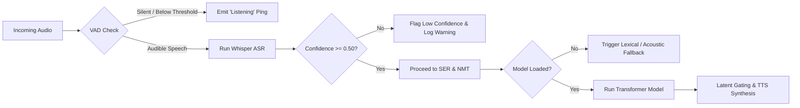

# Risk Register & Mitigation Strategy (docs/risk-register.md)

## Project: Bilingual Voice Translation System With Emotion Awareness (VoiceAffect)

---

## 1. Risk Categorization Matrix

| Risk ID | Category | Risk Description | Likelihood | Impact | Severity | Mitigation Strategy | Fallback Trigger |
| :--- | :--- | :--- | :--- | :--- | :--- | :--- | :--- |
| **RSK-001** | Scientific Integrity | **Unverified Paper Models (CAMuLeNet / TrustTranslate)**: Paper cites CAMuLeNet and TrustTranslate, but no open-source weights or packages exist publicly. | High | Critical | **High** | Transparently document unavailability. Implement verified open alternatives: Wav2Vec2 XLSR SER and physical acoustic-prosodic feature fusion (Eq. 5); implement Latent-Depth Gating as a neuro-symbolic mapping. | Lack of HuggingFace checkpoints. |
| **RSK-002** | Scientific Integrity | **Language Incompatibility in YourTTS**: Source paper proposes YourTTS, but official YourTTS models do not support Hindi Devanagari phonology out-of-the-box. | Definite | High | **High** | Utilize native high-quality Hindi synthesis engine (`Lekha`) with dynamic DSP pitch/rate/amplitude modulation. | Unsupported language token error in TTS. |
| **RSK-003** | System Performance | **Real-Time Latency Exceedance**: Cascaded processing (ASR + SER + NMT + Gating + TTS) takes $>3.5$s, disrupting conversational flow. | Medium | High | **Medium** | Use lightweight model variants (`whisper-tiny`, `opus-mt`), enforce Voice Activity Detection (VAD) to skip silent audio, and leverage Apple Silicon MPS acceleration. | Measured pipeline latency $>3500$ ms. |
| **RSK-004** | Error Propagation | **Cascaded ASR Failure**: Early phonetic transcription errors in Whisper cascade into garbled NMT translations and distorted emotional synthesis. | Medium | High | **High** | Calculate per-utterance confidence (Eq. 4). Display visual confidence badge in UI. Prompt user when confidence drops below $50\%$. | ASR confidence score $<0.50$. |
| **RSK-005** | Acoustic & Environmental | **Acoustic Noise Distortion**: Ambient background noise corrupts autocorrelation pitch tracking ($F_0$) and Mel filterbank energies. | High | Medium | **Medium** | Apply audio amplitude normalization, pre-emphasis, and adaptive RMS energy thresholding in `AudioProcessor`. | Low SNR or extreme high-frequency noise. |
| **RSK-006** | Hardware Limitations | **CPU Thermal Throttling / Lack of GPU**: Slower edge machines without Apple Silicon or CUDA take $>5$s per inference chunk. | Medium | Medium | **Medium** | Provide automatic device detection (`mps` $\rightarrow$ `cuda` $\rightarrow$ `cpu`). Allow users to toggle speech synthesis off to receive instant text-only translation. | Non-accelerated host hardware. |
| **RSK-007** | Privacy & Security | **Path Traversal & Unsafe Temp Storage**: Malicious uploaded file names could escape temporary directories or leak audio recordings. | Low | High | **High** | Hash temporary file names using UUIDv4 (`upload_raw_{uuid}.wav`). Strictly validate paths using `Path.resolve()`. Auto-unlink files post-processing. | Upload of files with `../` characters or non-audio MIME types. |
| **RSK-008** | Security & Privacy | **Denial of Service via Huge Media Files**: Submitting 500MB video files exhausts host memory during FFmpeg transcoding. | Medium | High | **High** | Enforce a strict 25 MB file size limit and validate MIME types against `ALLOWED_AUDIO_EXTENSIONS` (`.wav`, `.mp3`, `.m4a`, `.ogg`, `.flac`, `.webm`, `.mp4`). | Upload size $>25$ MB ($413$ Payload Too Large). |
| **RSK-009** | Network & Protocol | **WebSocket Dropped Connection**: Network jitter interrupts live audio streaming during conversational translation. | Low | Low | **Low** | Vanilla JS client includes automated reconnection loops and buffer recovery; handles graceful socket closure without UI freezing. | WebSocket `onclose` / `onerror` events. |
| **RSK-010** | Usability | **Microphone Access Denied**: Browser blocks microphone capture due to missing permissions or insecure HTTP origin. | Medium | High | **Medium** | Graceful exception catch in JavaScript with explanatory user modal instructing how to allow microphone permissions in browser settings. | `navigator.mediaDevices.getUserMedia` rejection. |
| **RSK-011** | Security | **TTS CLI Argument Injection**: Translated text beginning with `--` or `-` flags alters subprocess parameters when invoking `/usr/bin/say`. | Low | High | **High** | Fixed in Phase 7: Pipe translated text strictly via `stdin` (`input=text.encode('utf-8')`) with `shell=False`. | Leading hyphens in translated output. |
| **RSK-012** | Model Accuracy | **SER Cross-Lingual Affective Bias**: Wav2Vec2-XLSR SER was fine-tuned on the English RAVDESS corpus; Hindi speech classification relies on acoustic prosody rather than native affective lexicon. | High | Medium | **Medium** | Explicitly documented in model matrix, evaluation report, and UI telemetry. Never claim full Hindi emotional lexical comprehension. | Non-English input audio. |

---

## 2. Risk Monitoring & Operational Triggers

All fallbacks, degraded modes, and diagnostic logs are truthfully recorded and surfaced in the application's `/api/health` response and UI telemetry cards.
