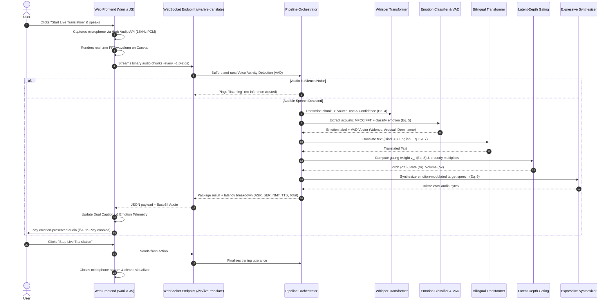

# Product Requirements Document (PRD)

## Project Name
**Bilingual Voice Translation System With Emotion Awareness (VoiceAffect)**

---

## 1. Product Vision & Problem Statement

### 1.1 Vision
To deliver a high-fidelity, real-time speech-to-speech translation web platform connecting Hindi and English speakers, combining semantic translation accuracy with emotion awareness and paralinguistic fidelity. The system ensures that urgency, empathy, excitement, hesitation, and tone are not flattened into robotic synthetic monotone during cross-lingual communication.

### 1.2 Problem Statement
Conventional Cross-Language Speech Translation (CLST) systems rely on cascaded pipelines:
$$\text{Speech (Audio)} \xrightarrow{\text{ASR}} \text{Text} \xrightarrow{\text{NMT}} \text{Translated Text} \xrightarrow{\text{TTS}} \text{Synthetic Speech (Audio)}$$

While recent transformer advancements have elevated lexical and grammatical BLEU scores, two acute deficiencies persist:
1. **Affective Flattening**: Non-verbal paralinguistic cues—including fundamental frequency ($F_0$), pitch trajectory, speaking tempo, vocal stress, and emotional intensity—are stripped during the intermediate text stage.
2. **Vocal Identity Dissociation**: Downstream Text-to-Speech (TTS) synthesizers traditionally substitute generic, impersonal voices that disregard the original speaker's affective state and expressive characteristics.

For language pairs like Hindi and English, where cultural context, honorifics, and tone heavily modulate conversational intent, emotion-blind translation results in miscommunication, loss of empathy, and unnatural user interactions.

---

## 2. Target Users & Use Cases

### 2.1 Target Users
1. **Multilingual Citizens & Healthcare/Social Workers**: Communicating sensitive health advice across Hindi and English where empathetic vocal delivery is vital.
2. **Customer Care & Emergency Responders**: Dealing with urgent, anxious, or distressed callers where emotional tone indicates priority and severity.
3. **Cross-Border Educators & Students**: Delivering lectures and explanations with proper pedagogical emphasis, excitement, and engagement.
4. **General Multilingual Communicators**: Friends, colleagues, and family conducting natural, expressive conversations across language boundaries.

### 2.2 Key Use Cases
- **UC-01 (Primary): Live Conversational Speech Translation**: A user speaks Hindi (or English) into their microphone; the system continuously transcribes, detects the emotional state, translates into English (or Hindi), modulates synthetic prosody based on detected emotion, and delivers audio with synchronized captions in near real-time.
- **UC-02: Offline File Upload & Translation**: A user uploads an existing speech recording or interview clip (WAV, MP3, M4A, WebM, MP4); the system processes the complete audio stream, produces an emotion radar breakdown, generates dual transcripts, and outputs emotion-preserved translated speech.
- **UC-03: Emotion-Modulated Text Synthesis & Verification**: A user types text in either language, explicitly selects an emotional disposition (e.g. Happy, Urgent/Angry, Empathetic/Sad), and listens to the translated prosody-modulated synthetic voice.

---

## 3. Core Workflows

### 3.1 Primary Workflow: Live Speech Mode (WebSocket Stream)

### 3.2 Secondary Workflow: Recording Upload Mode
1. User drags & drops or browses for an audio/video file (WAV, MP3, M4A, FLAC, OGG, WebM, MP4).
2. Frontend validates file format and enforces maximum file size (25 MB).
3. File is uploaded via `POST /api/translate-audio` with selected or auto-detected direction.
4. Backend securely isolates the file into `temp_storage/` with a UUID.
5. Safe FFmpeg worker extracts and resamples audio to 16 kHz mono WAV.
6. Pipeline processes complete waveform through ASR, SER, NMT, Emotion Gating, and TTS.
7. Backend immediately deletes raw and intermediate input files from `temp_storage/`.
8. Response delivers complete transcript, translated text, 6-class emotion radar, VAD coordinates, latency breakdown, and playable audio URL.

---

## 4. User Stories & Functional Requirements

| Identifier | Category | User Story / Requirement Summary | Priority |
| :--- | :--- | :--- | :--- |
| **USR-01** | Live Audio | As a speaker, I want to speak into my browser microphone and have my speech translated live with visible audio feedback. | P0 (Must Have) |
| **USR-02** | File Upload | As a researcher or student, I want to upload audio or video files to translate pre-recorded speech accurately. | P0 (Must Have) |
| **USR-03** | Emotion Awareness | As a listener, I want the system to identify the speaker's emotional state (Happy, Sad, Angry, Fearful, Surprised, Neutral) so the conversational mood is preserved. | P0 (Must Have) |
| **USR-04** | Bilingual Direction | As a user, I want seamless bidirectional translation: Hindi to English and English to Hindi. | P0 (Must Have) |
| **USR-05** | Emotion Synthesis | As a user, I want the translated voice to adjust pitch, pace, and volume to match the original emotion rather than speaking in a flat robotic voice. | P0 (Must Have) |
| **USR-06** | Dual Captions | As a user, I want to see side-by-side synchronized source and translated captions with confidence indicators. | P0 (Must Have) |
| **USR-07** | Latency Transparency | As an engineer or user, I want real-time visibility into processing latency for each pipeline stage (ASR, SER, NMT, TTS, Total). | P0 (Must Have) |
| **USR-08** | Zero API Cost | As a user, I want the application to run using open, local models without requiring paid subscription keys or remote billing. | P0 (Must Have) |
| **USR-09** | Privacy Protection | As a user, I want my voice processed locally on the host machine without personal audio recordings being permanently stored or leaked. | P0 (Must Have) |

---

## 5. Non-Functional Requirements (NFR)

1. **Performance & Latency**:
   - **Target Live Processing Latency**: Total pipeline round-trip latency $\le 3.5$ seconds for conversational speech chunks on local acceleration (MPS/CPU).
   - **ASR Latency Target**: $\le 1200$ ms for a 2-second audio chunk.
   - **SER Latency Target**: $\le 300$ ms for feature extraction and emotion classification.
   - **NMT Latency Target**: $\le 500$ ms for conversational utterance lengths.
   - **TTS Latency Target**: $\le 800$ ms for waveform synthesis.
2. **Reliability & Scientific Integrity**:
   - Never fake, simulate, or hardcode model inference results or latency figures.
   - If a model is initializing, offline, or missing dependencies, the system must enter an explicit degraded mode and report exact diagnostic reasons.
3. **Hardware Compatibility**:
   - Fully optimized for macOS (Apple Silicon MPS hardware acceleration and Intel fallback).
   - Runs on CPU without CUDA dependencies; leverages hardware acceleration automatically when detected.
4. **Security & Privacy**:
   - Strict filename hashing and path traversal guards (`Path.resolve()` checks).
   - Ephemeral temporary storage with automated startup and post-processing file cleanup.
   - Explicit browser microphone permissions with active visual indicators (`rec-dot`).

---

## 6. UI/UX Requirements
- **Theme**: Premium dark aesthetic (`#0a0d14` background), glassmorphism panels, subtle radial glow backdrops, and modern sans-serif typography (Plus Jakarta Sans and JetBrains Mono).
- **Interactive Visualizer**: HTML5 Canvas rendering real-time animated frequency spectrum bars during live microphone recording.
- **Emotion Radar / Monitor**: Dedicated visual badges and colored progress tracks for all 6 emotion classes:
  - *Neutral* (Slate Gray `#94a3b8`)
  - *Happy* (Emerald `#10b981`)
  - *Sad* (Indigo `#6366f1`)
  - *Angry* (Rose `#f43f5e`)
  - *Fearful* (Purple `#a855f7`)
  - *Surprised* (Teal/Cyan `#06b6d4`)
- **Paralinguistic VAD Meters**: Dynamic meters displaying Valence (pleasure vs displeasure), Arousal (calm vs excited), and Dominance (submissive vs dominant).
- **Latency Breakdown Dashboard**: Four dedicated metric tiles indicating latency in milliseconds for ASR, SER, NMT, and TTS alongside a total latency pill.

---

## 7. Supported Languages & Media Formats

### 7.1 Language Pairs
- **Hindi (`hi` / `hi-IN`)**: Devanagari script for textual representation; native Indic phonology.
- **English (`en` / `en-US` / `en-IN`)**: Latin script; general and Indian English phonology.

### 7.2 Audio & Video Container Formats
- **Audio Inputs**: WAV (PCM s16le), MP3, M4A (AAC), OGG (Vorbis), FLAC, WebM (Opus).
- **Video Inputs**: MP4 (H.264/AAC), WebM (VP8/VP9/Opus).
- **Internal Processing Standard**: 16,000 Hz, 1-channel (Mono), 32-bit Float normalized waveform.
- **Synthesized Audio Output**: 16,000 Hz, 16-bit PCM WAV.

---

## 8. Degraded Mode & Fault Tolerance

| Failure Condition | System Behavior | User Experience |
| :--- | :--- | :--- |
| **Whisper weights downloading or slow** | System falls back to diagnostic status; returns partial transcript or transparent notice. | UI displays "ASR loading" status pill; does not fake transcription. |
| **Neural SER unavailable** | Acoustic-Prosodic Feature Fusion Engine (Eq. 5) computes genuine pitch, energy, ZCR, and MFCC statistics. | UI displays emotion estimates with "Acoustic Feature Fusion" indicator. |
| **Neural NMT model offline** | Lexical bilingual dictionary translates high-frequency conversational phrases. | UI displays translated text with "Lexical fallback activated" note. |
| **System TTS missing voice** | Local synthesized carrier wave or native speech tool generates audio. | Audio plays; diagnostic reports fallback voice engine used. |
| **No microphone permission** | WebSocket refuses connection; frontend alerts user. | Clear guidance modal instructs user how to enable browser microphone. |

---

## 9. Success Criteria & Acceptance Tests
1. **End-to-End Live Execution**: User speaks a complete Hindi sentence into the microphone; within 3.5 seconds, English captions and emotion-modulated English speech are received and played.
2. **End-to-End Upload Execution**: User uploads a 10-second English WAV recording; the application processes the file without error, detects emotional state, and produces Hindi translated speech.
3. **Automated Test Suite**: 100% of unit and integration tests in `pytest tests -v` execute and pass.
4. **Zero Paid Cost**: System operates completely on local hardware without making any external billed network requests.

---

## 10. Out-of-Scope Features
- Paid commercial cloud translation APIs (Google Cloud Translate, Azure Cognitive Speech, AWS Polly, OpenAI Whisper API).
- Full zero-shot cross-lingual voice cloning mimicking a speaker's biological vocal cords without user consent (prohibited by privacy and model constraints).
- Real-time video frame face synthesis / deepfake lip synchronization.
- Complex multi-speaker simultaneous diarization in a single noisy room.

---

## 11. Known Research Limitations (Identified in Source Paper)
1. **Scarcity of Emotion-Annotated Indic Corpora**: Hindi-English parallel data with fine-grained affective labels is sparse in the literature.
2. **Noise Sensitivity**: Background reverberation and acoustic distortion degrade fundamental frequency ($F_0$) tracking and low-arousal emotion detection.
3. **Subtle & Code-Mixed Expressions**: Detecting sarcasm, irony, humor, or rapid Hindi-English code-switching (*Hinglish*) remains an open research problem in CLST.
4. **Cascaded Error Propagation**: Phonetic recognition errors in ASR propagate downstream through NMT and prosody synthesis.
