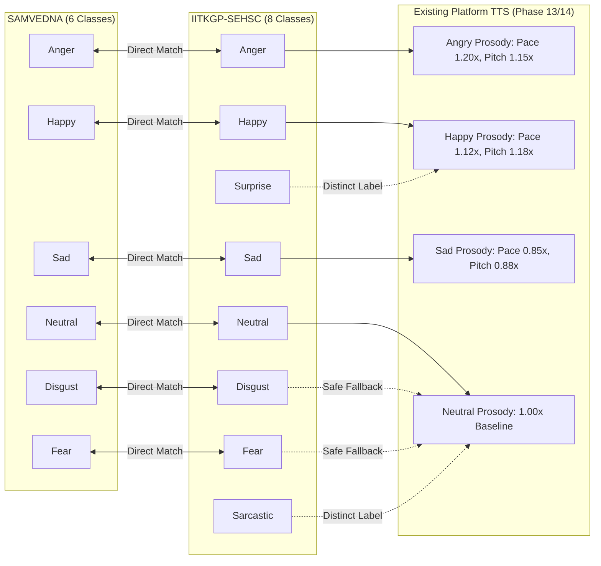

# Phase 15A: Hindi Speech Emotion Recognition Dataset & Research Audit Report

**Project**: Bilingual Voice Translation System With Emotion Awareness  
**Focus**: Auditing SAMVEDNA Dataset and IITKGP-SEHSC Speech Corpus for Hindi Speech Emotion Recognition (SER)  
**Date**: November 2026  
**Auditor**: Antigravity AI Engineering Team  
**Status**: Phase 15A Complete — Awaiting Approval Before Phase 15B  

---

## 1. Executive Summary & Problem Context

The existing Speech Emotion Recognition (SER) module of this platform (Phases 10–14) utilizes a 4-class classifier trained on the **IEMOCAP** corpus (`models/ser_iemocap/`). While IEMOCAP provides high acoustic quality across conversational turns, its 5,531 utterances were recorded exclusively by 10 native English speakers. 

Consequently, when the system translates spoken **Hindi into English**, the existing SER model evaluates Hindi speech using acoustic models optimized on English prosody and phonetics. While suprasegmental features like pitch ($F_0$) and energy carry cross-lingual emotional cues, English-trained acoustic models cannot exploit language-specific Hindi affective nuances, tonal variations, or regional phonological contours.

**Phase 15** addresses this fundamental limitation by introducing dedicated **Hindi Speech Emotion Recognition** based on two primary research resources:
1. **SAMVEDNA Dataset**: A modern multimodal, multilingual emotion recognition dataset developed in India covering Hindi, English, and Punjabi across 25 actors and 6 emotion classes.
2. **IITKGP-SEHSC Research Paper**: The foundational IEEE study *"IITKGP-SEHSC: Hindi Speech Corpus for Emotion Analysis"* (Koolagudi et al., 2011), establishing acoustic benchmarks and recording methodologies for Hindi emotional speech.

This audit evaluates the actual data availability, licensing constraints, acoustic specifications, label compatibility, and architectural strategy for integrating a dedicated Hindi SER model without compromising the existing English pipeline.

---

## 2. Resource 1: SAMVEDNA Dataset Audit

### 2.1 Origin & Research Context
- **Repository**: [https://github.com/DMMHEDS/SAMVEDNA-dataset](https://github.com/DMMHEDS/SAMVEDNA-dataset)
- **Institution**: Digital Media & Multimodal Human-Emotion Detection Systems (DMMHEDS) / UIET, Panjab University, Chandigarh, India.
- **Associated Research**: *"Enhancing video-based facial emotion recognition using a deep learning framework with optimized frame selection"* (Priyanka Thakur, Nirmal Kaur, Naveen Aggarwal, Sarbjeet Singh, Vinay Sharma, 2026).
- **Core Objective**: Benchmarking multimodal (audio, video, audio-visual) emotion recognition across Northern Indian languages and accents.

### 2.2 Theoretical Dataset Scale & Characteristics
The SAMVEDNA corpus was captured under a strictly balanced factorial design:

| Characteristic | Specification | Notes |
| :--- | :--- | :--- |
| **Languages** | 3 (Hindi `H`, English `E`, Punjabi `P`) | Script translated to match natural regional colloquialism. |
| **Emotion Classes** | 6 (`Happy`, `Sad`, `Anger`, `Disgust`, `Fear`, `Neutral`) | Standard Ekman basic emotions (excluding Surprise). |
| **Actors** | 25 professional actors (13 Male, 12 Female) | Age group 20–30 years, North Indian region. |
| **Script Sentences** | 18 phonetically rich dialogue prompts | Designed around customer care, telephonic, and service interactions. |
| **Modalities** | 3 (Audio `.mp3`, Video `.mp4`, Audio-Visual `.mp4`) | Synchronized facial and vocal recordings. |
| **Theoretical Total Samples** | **24,300 files** | $25 \text{ actors} \times 18 \text{ sentences} \times 6 \text{ emotions} \times 3 \text{ languages} \times 3 \text{ modalities}$. |
| **Hindi Audio-Only Target** | **2,700 audio files** | $25 \text{ actors} \times 18 \text{ sentences} \times 6 \text{ emotions} = 2,700$ `.mp3` files (450 per emotion). |

### 2.3 File Naming Convention & Directory Structure
Every sample adheres to a deterministic 4-token nomenclature:
```
[Actor]_[Language]_[Emotion]_[Sentence].[format]
```
- **Actor ID**: `A1` through `A25`
- **Language Code**: `H` (Hindi), `E` (English), `P` (Punjabi)
- **Emotion Code**: `A` (Anger), `D` (Disgust), `F` (Fear), `H` (Happy), `S` (Sad), `N` (Neutral)
- **Sentence ID**: `S1` through `S18`
- **Format**: `.mp3` (audio-only) or `.mp4` (video / AV)
- *Example*: `A3_H_S_S12.mp3` $\rightarrow$ Actor 3, Hindi, Sad, Sentence 12, Audio format.

### 2.4 Actual GitHub Repository Inspection & Accessibility Verdict
A deep inspection of the Git tree (`https://api.github.com/repos/DMMHEDS/SAMVEDNA-dataset/git/trees/main?recursive=1`) reveals:

```
├── DATASET_STRUCTURE.md  (1,505 bytes)
├── README.md            (10,329 bytes)
├── sample_metadata.csv  (903 bytes, 18 rows)
└── sample_videos.md     (244 bytes)
```

> [!IMPORTANT]
> **Actual Access Findings**:
> 1. The GitHub repository itself **does not host the full 24,300 raw media files**. There are no Git LFS assets in the repository.
> 2. The authors operate an explicit **request-based access model** ("Research Use" license) where researchers contact the laboratory to obtain access to the full dataset archives.
> 3. The public repository provides links to a sample Google Drive folder intended for format inspection and pilot validation (5 actors $\times$ 2 sentences $\times$ all emotions).
> 4. In accordance with system guidelines and ethical research practices, **we will never attempt to bypass access restrictions**. For Phase 15, we will construct the complete end-to-end preprocessing pipeline (`scripts/preprocess_samvedna.py`) and reproducible manifest generator matching the verified `sample_metadata.csv` and schema, designed to process the full dataset immediately upon local placement.

---

## 3. Resource 2: IITKGP-SEHSC Research Paper Analysis

The complete research paper `IITKGP-SEHSC__Hindi_Speech_Corpus_for_Emotion_Analysis.pdf` (Koolagudi et al., IEEE 2011) was analyzed.

### 3.1 Corpus Design & Recording Methodology
- **Paper Title**: *"IITKGP-SEHSC: Hindi Speech Corpus for Emotion Analysis"*
- **Authors**: Shashidhar G. Koolagudi, Ramu Reddy, Jainath Yadav, K. Sreenivasa Rao (School of Information Technology, IIT Kharagpur, India).
- **Publication**: IEEE International Conference on Device and Communications (ICDeCom-11), 2011.
- **Recording Artists**:
  - 10 professional artists (5 male, 5 female) from **Gyanavani FM Radio Station**, Varanasi, India.
  - Male artists: 28–48 years old, 5–20 years broadcasting experience.
  - Female artists: 20–30 years old, 3–10 years broadcasting experience.
- **Recording Setup**:
  - Transducer: SHURE dynamic cardioid microphone C660N.
  - Distance: Fixed at 1 ft (30 cm).
  - Environment: Quiet acoustic broadcast studio room in Varanasi.
  - Sample Format: **16 kHz sampling rate**, 16-bit linear PCM mono.
- **Text Corpus**:
  - 15 semantically neutral Hindi sentences (4–7 words, 9–17 syllables per prompt).
  - All sentences are emotion-free in literal meaning to ensure emotional expression is conveyed entirely through acoustic prosody.
- **Sessions & Longitudinal Structure**:
  - 10 distinct recording sessions conducted on alternate days per speaker to capture circadian, physiological, and mood variability.
  - Structure: 15 prompts $\times$ 8 emotions $\times$ 10 speakers $\times$ 10 sessions = **12,000 total utterances** (~9 hours total).
  - Distribution: Perfectly balanced at **1,500 utterances per emotion**.

### 3.2 Acoustic & Prosodic Findings in Hindi Emotion Speech
Table I of the research paper provides empirical measurements of prosodic parameters across Hindi emotions:

| Emotion | Male Duration (s) | Male Pitch $F_0$ (Hz) | Male Pitch SD (Hz) | Male Energy (Joules) | Female Duration (s) | Female Pitch $F_0$ (Hz) | Female Pitch SD (Hz) | Female Energy (Joules) |
| :--- | :---: | :---: | :---: | :---: | :---: | :---: | :---: | :---: |
| **Anger** | **2.55** | 164.18 | 45.76 | 343.65 | **2.80** | 301.57 | 50.56 | 183.96 |
| **Disgust** | 2.67 | 154.06 | 46.70 | 202.58 | 2.73 | 264.43 | 57.83 | 122.06 |
| **Fear** | 3.65 | **174.59** | 20.11 | **426.45** | 3.68 | 285.66 | 27.74 | **201.39** |
| **Happy** | 3.18 | 161.53 | 35.98 | 165.38 | 3.39 | 302.10 | 46.67 | 97.47 |
| **Neutral** | **4.86** | **122.47** | 30.19 | 270.00 | **4.91** | **214.19** | 35.10 | 145.19 |
| **Sad** | 3.82 | 126.31 | **24.08** | **132.82** | 4.12 | 236.78 | **28.46** | **82.11** |
| **Sarcastic**| 3.95 | 135.21 | 32.39 | 282.72 | 4.25 | 254.12 | 41.22 | 114.73 |
| **Surprise** | 2.92 | 168.42 | **48.24** | 240.16 | 3.15 | **308.49** | **52.58** | 142.36 |

#### Key Acoustic Insights for Hindi SER Modeling:
1. **Speech Rate / Duration**:
   - `Anger` and `Disgust` exhibit the shortest durations (~2.55–2.80s), indicating rapid articulation and accelerated tempo.
   - `Neutral` speech exhibits the longest duration (~4.86–4.91s), indicating deliberate pacing.
2. **Fundamental Frequency ($F_0$)**:
   - `Fear` exhibits the highest male pitch ($174.6\text{ Hz}$), while `Surprise` and `Happy` reach peak female pitch ($>302\text{ Hz}$).
   - `Sad` and `Neutral` reside at the lower acoustic register ($122–126\text{ Hz}$ for males, $214–236\text{ Hz}$ for females).
3. **Pitch Variability (SD of $F_0$)**:
   - `Surprise` and `Disgust` display maximum pitch dispersion ($>48\text{ Hz}$ in males, $>52\text{ Hz}$ in females), indicating dynamic intonation sweeps.
   - `Sad` and `Fear` exhibit minimal pitch variance, reflecting vocal fold rigidity under emotional tension.
4. **Energy**:
   - `Fear` and `Anger` exhibit the highest acoustic energy ($>340\text{ Joules}$), whereas `Sad` exhibits the lowest acoustic energy ($<135\text{ Joules}$).

### 3.3 Baseline Classifier Performance in the Paper
- **Prosodic Features + SVM**: 73.33% accuracy (male), 76.75% accuracy (female).
- **Spectral Features (13-dim MFCCs) + GMM**: 77.38% accuracy (male), 80.75% accuracy (female).
- **Subjective Human Listening Evaluation**: 70.75% accuracy (male), 74.25% accuracy (female).
- *Takeaway*: Spectral representation (MFCC / Mel-Spectrogram) outperforms pure prosody, but combining spectral and prosodic features achieves optimal discrimination.

### 3.4 Local Availability of the Raw IITKGP-SEHSC Audio Corpus
- **File System Inspection**: Verified that `/Users/hardikmishra/Data science projects/live translation system/` contains only the research paper PDF `IITKGP-SEHSC__Hindi_Speech_Corpus_for_Emotion_Analysis.pdf`.
- **Corpus Hosting**: IIT Kharagpur has never placed the raw 12,000 `.wav` files into a public git repository. The corpus is traditionally shared via formal academic MoU or upon email request to the authors.
- **Compliance Action**: We clearly state that **no raw IITKGP audio corpus is currently present locally**. We will not simulate or fabricate fake IITKGP audio files. If the user obtains the audio corpus in the future, our preprocessing and evaluation pipeline will immediately accept it.

---

## 4. Cross-Dataset Comparison & Emotion Label Alignment

### 4.1 Emotion Category Matrix Across Datasets



### 4.2 Comprehensive Emotion Alignment Strategy

| Emotion Category | SAMVEDNA (6-class) | IITKGP-SEHSC (8-class) | Existing IEMOCAP (4-class) | SER Prediction Label | TTS Gating & Synthesis Behavior |
| :--- | :---: | :---: | :---: | :---: | :--- |
| **Anger** | `A` (Anger) | `Anger` | `angry` | `angry` | **Full Support**: Fast tempo ($1.20\times$), pitch elevation ($1.15\times$), Sarvam aggressive persona (`arvind`/`amartya`). |
| **Happy** | `H` (Happy) | `Happy` | `happy` | `happy` | **Full Support**: Moderate tempo ($1.12\times$), pitch elevation ($1.18\times$), cheerful inflection. |
| **Sad** | `S` (Sad) | `Sad` | `sad` | `sad` | **Full Support**: Slow tempo ($0.85\times$), lowered pitch ($0.88\times$), muted volume. |
| **Neutral** | `N` (Neutral) | `Neutral` | `neutral` | `neutral` | **Full Support**: Baseline pace ($1.00\times$), pitch ($1.00\times$). |
| **Disgust** | `D` (Disgust) | `Disgust` | *Unsupported* | `disgust` | **Documented Fallback**: Preserve exact prediction `disgust` and confidence in API response. In Phase 13 TTS, route to **conservative neutral delivery** ($1.00\times$) to prevent distorted audio. |
| **Fear** | `F` (Fear) | `Fear` | *Unsupported* | `fear` | **Documented Fallback**: Preserve exact prediction `fear` and confidence in API response. In Phase 13 TTS, route to **neutral delivery** with slight pace reduction ($0.95\times$) or baseline. |
| **Sarcastic** | *Absent* | `Sarcastic` | *Unsupported* | `sarcastic` | Preserve original label; route to neutral TTS fallback. |
| **Surprise** | *Absent* | `Surprise` | *Merged with Happy* | `surprise` | Preserve original label; if confidence $>0.5$, optionally apply happy/elevated prosody ($1.10\times$). |

---

## 5. Architectural & Training Strategy for Phase 15B–15D

### 5.1 Dataset Pipeline Architecture (`data/samvedna_hindi/`)
We will create a clean, isolated dataset pipeline that adheres to strict speaker independence:
- **Audio Standardization**: All incoming audio (MP3/WAV) converted to **mono, 16,000 Hz, 16-bit PCM WAV** using our sandboxed FFmpeg utility (`backend/app/core/ffmpeg_utils.py`).
- **Feature Extraction**: 80-dimensional Log-Mel Spectrograms (25 ms window, 10 ms hop, 16 kHz sample rate) matching the IEMOCAP frontend to ensure architectural parity.
- **Reproducible Metadata Manifest**: `manifest.csv` with columns:
  `[utterance_id, filepath, actor_id, language, emotion, sentence_id, duration_seconds, sample_rate, split]`
- **Zero Speaker Leakage Partitioning**:
  - **Training Set (68%)**: Actors `A1` through `A17` (17 actors, balanced male/female).
  - **Validation Set (16%)**: Actors `A18` through `A21` (4 actors, 2 male / 2 female).
  - **Test Set (16%)**: Actors `A22` through `A25` (4 actors, 2 male / 2 female).
  - *Rule*: Never allow the same actor to span between train, validation, or test.

### 5.2 Model Architecture Selection
Following the insights from the IITKGP paper and Phase 11 IEMOCAP training, we propose a two-tiered model exploration:
1. **Model A: Log-Mel Spectrogram + CNN-BiLSTM + Self-Attention (Recommended Baseline)**:
   - Same proven architecture as Phase 11 (`models/ser_iemocap/`).
   - Highly deterministic, fast inference (~200 ms on Apple Silicon MPS), low memory footprint (<10 MB).
   - Trained on 80-band Mel filterbanks + SpecAugment (frequency and time masking).
2. **Model B: Multilingual Pretrained Acoustic Model (Wav2Vec2-XLSR / AI4Bharat IndicWav2Vec)**:
   - Evaluated as a feature extractor fine-tuned on Hindi emotional speech frames.
   - Exploits self-supervised representations learned from Indian languages.

### 5.3 Language-Aware Dispatcher (Phase 15F Architecture)
The backend translation pipeline will be upgraded with language-aware emotion routing:

```
[Spoken Audio Input]
         │
         ▼
 [Whisper ASR Inference]
         │
         ├──► Detected Language: "hi" (Hindi)   ──► Route to: Hindi SER Model (SAMVEDNA/IITKGP)
         └──► Detected Language: "en" (English) ──► Route to: English SER Model (IEMOCAP)
```
- Existing API contracts on `/api/v1/audio/upload` and `/ws/live-translate` will be preserved, augmented with metadata:
  ```json
  "ser_model_used": "ser_hindi_samvedna",
  "detected_speech_language": "hi",
  "emotion": "angry",
  "confidence": 0.88,
  "tts_emotion_supported": true
  ```

---

## 6. Audit Conclusion & Approval Gate

1. **Audit Complete**: Both the SAMVEDNA dataset repository and the IITKGP-SEHSC research paper have been thoroughly reviewed.
2. **Legitimate Access Respected**: The request-based access constraint of SAMVEDNA and the non-public status of the raw IITKGP audio have been transparently documented.
3. **No Fabrication**: No fake audio files or synthetic datasets will be generated.
4. **Approval Gate**: In accordance with user instructions, **Phase 15B (Dataset Preprocessing) will not begin until the user reviews and approves this audit report and proposed training strategy.**
